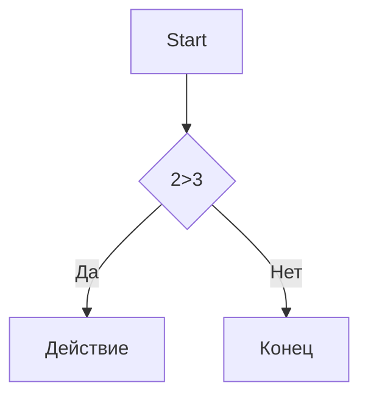

# Заголовок 1 
## Заголовок 2
### Заголовок 3
#### Заголовок 4
##### Заголовок 5
###### Заголовок 6

*курсив*
**жирный** 
***Жирный и курсив*** 
~~зачеркнутый~~
`моноширинный код` 

- Пункт 1
- Пункт 2
  - Вложенный
  - ещё
* Пункт 3
+ Пункт 4

1. Первый
2. Второй
3. Третий
   1. Вложенный
   2. Ещё

- [x] 1
- [ ] 2
- [ ] 3


[текст ссылки](https://example.com)

[С подсказкой](https://example.com "При наведении")

<https://auto-link.com>

[Ссылочный стиль][1]

[1]: https://example.com


[](https://ru.pinterest.com/ideas/обои-для-рабочего-стола-компьютера/929790009455/)


>Цитата
>Много строк
>
> > Вложенная


```markdown
print("Hello") Python
```

```python
c = a+b
print(f"{c} = {a} + {b}")
```


```markdown
print("Hello") Python
```

```python
c = a+b
print(f"{c} = {a} + {b}")
```


---
***
___


\# fdf

\[ dsdssd \]





- [Заголовки](#1-заголовки)
- [Списки](#3-спи 